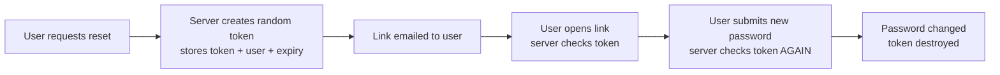

# Password Reset Vulnerabilities

> Study notes on how "Forgot password" features get broken, with real-world cases and fixes.
> For learning and **authorized testing only** (e.g. PortSwigger Web Security Academy labs, your own apps, bug bounty programs within scope).

---

## Table of Contents

1. [Why password reset is a prime target](#why-password-reset-is-a-prime-target)
2. [Sending passwords by email](#1-sending-passwords-by-email)
3. [Reset URLs with a guessable identifier](#2-reset-urls-with-a-guessable-identifier)
4. [Token-based reset URLs (and where they break)](#3-token-based-reset-urls-and-where-they-break)
5. [Lab walkthrough: Password reset broken logic (PortSwigger)](#lab-walkthrough-password-reset-broken-logic-portswigger)
6. [Real-world incidents](#real-world-incidents)
7. [Defender checklist](#defender-checklist)
8. [Tester checklist (Burp Suite)](#tester-checklist-burp-suite)
9. [References](#references)

---

## Why password reset is a prime target

A login form asks, "Do you know the secret?" A reset form asks, "Can you prove you're the owner **without** knowing the secret?" That second question is much harder to answer safely.

Whoever completes a reset becomes the account owner. So a weakness in this flow is usually a **full account takeover** with no need to crack or steal the existing password. Attackers treat it as an alternative login door, and it is often guarded less carefully than the front one.

---

## 1. Sending passwords by email

### What it is
The user clicks "Forgot password" and the site emails them a password, either a freshly generated one or (worse) their current one.

### Why it is dangerous
- **Emailing the *current* password** means the site stores passwords in a recoverable form (plaintext or reversible encryption). That is a red flag on its own, because passwords should only ever be stored as salted hashes.
- **Emailing a *new* password** is less bad, but the password sits in an inbox until someone changes it. Inboxes are permanent, synced across phones and laptops, shared on family computers, and read by many third-party apps.
- Email travels through servers the site does not control, so there is no guarantee it stays private in transit.

### How an attack looks

| Step | What happens |
|------|--------------|
| 1 | The attacker gains access to the victim's mailbox (phishing, reused password, a shared device, a leaked backup). |
| 2 | They search the inbox for old "Your password" emails. |
| 3 | The emailed password still works, because the victim never changed it. They log in. |

### Safer approach
Never send a password at all. Send a one-time, expiring reset link instead (see section 3), and force the user to choose their own new password.

---

## 2. Reset URLs with a guessable identifier

### What it is
The reset link tells the server *which account* to reset by putting an obvious identifier in the URL:

```
https://shop.example/reset-password?user=alice
```

### Why it is dangerous
The link carries **no proof** that the person clicking it received an email. The identifier is the only thing selecting the account, and the attacker controls it.

### How an attack looks

| Step | What happens |
|------|--------------|
| 1 | The attacker requests a reset for their own account and receives `.../reset-password?user=attacker`. |
| 2 | They notice the pattern and edit the parameter to `user=victim`. |
| 3 | The server shows a "choose a new password" form for the victim. |
| 4 | The attacker sets a password they know and logs in as the victim. |

### Common variants
- Numeric IDs that can be counted through: `?id=1041`, `?id=1042`
- "Hidden" values that are easily reversed: a Base64-encoded email address, or an MD5 of the username
- Tokens built from the time of request or a counter, which can be guessed or narrowed down

### Real-world flavour
This exact pattern is mostly seen in homegrown or legacy apps rather than in famous breaches, so there is no single headline incident I can point to. The closely related lesson from big companies is in [Real-world incidents](#real-world-incidents): when the secret that proves identity is weak, accounts fall.

### Safer approach
Identify the account from a random token stored on the server, never from a parameter the user can edit.

---

## 3. Token-based reset URLs (and where they break)

### What a good implementation looks like
The server generates a long random token, stores it with the account it belongs to, and emails a link such as:

```
https://shop.example/reset-password?token=9f3c...(long random value)
```

When the link is opened, the server looks the token up and works out which user it belongs to. The URL says nothing about the user.



A strong token is:
- **Unpredictable**: generated by a cryptographically secure random source
- **Bound** to exactly one account, on the server side
- **Short-lived**: expires after a short window (minutes, not days)
- **Single-use**: deleted as soon as the password is changed

### The classic failure: token not checked again on submit

Many apps check the token when the page loads, but not when the form is submitted. The form usually carries the token and the username as hidden fields, and the submit handler trusts the username.

**Normal request (from the victim's own reset form):**

```http
POST /reset-password HTTP/1.1
Host: vulnerable-website.com
Content-Type: application/x-www-form-urlencoded

token=9f3c...&username=alice&new-password=NewPass123
```

**Attack:**

| Step | What happens |
|------|--------------|
| 1 | The attacker requests a reset for **their own** account and opens the emailed link. |
| 2 | They submit the form while intercepting the request (e.g. in Burp Repeater). |
| 3 | They delete the token value (or replace it with garbage) and change `username` to the victim. |
| 4 | The server never validates the token on this request, so it resets the victim's password. |

The page-load check protected the *form*, but not the *action*. The action is what matters.

### Other ways token-based resets fail
- **Predictable tokens**: based on time, a counter, or a weak random generator
- **No expiry or reuse allowed**: an old email stays dangerous forever
- **No rate limiting on short codes**: a 6-digit code has only a million possibilities
- **Token leakage**: the reset URL leaks through the `Referer` header to third-party scripts or images on the reset page
- **Host header poisoning**: the app builds the emailed link from the request's `Host` header, so an attacker can make the link point to their own server and capture the token

---

## Lab walkthrough: Password reset broken logic (PortSwigger)

**Lab:** Password reset broken logic — Apprentice
**Your credentials:** `wiener:peter`
**Victim:** `carlos`
**Goal:** Reset Carlos's password without ever knowing it, then open his "My account" page.

This lab is a hands-on build of the exact flaw covered above in [The classic failure: token not checked again on submit](#3-token-based-reset-urls-and-where-they-break): the token is checked when the reset page loads, but not when the new password is submitted.

### Step 1 — See the normal flow, with Burp running
- Log in with `wiener:peter`, then log back out.
- Click **Forgot your password?** and enter your own username, `wiener`.
- Open the **Email client** button and open the reset email. The link in it carries the reset token as a URL query parameter:
  ```
  GET /forgot-password?temp-forgot-password-token=a1b2c3...
  ```
- Click the link and set a new password for yourself (anything works, e.g. `test`/`test`).

### Step 2 — Find the request that actually changes the password
- In Burp, go to **Proxy > HTTP history** and find the submit request you just made. It looks like:
  ```http
  POST /forgot-password?temp-forgot-password-token=a1b2c3... HTTP/1.1
  Host: 0a12...web-security-academy.net
  Content-Type: application/x-www-form-urlencoded

  temp-forgot-password-token=a1b2c3...&username=wiener&new-password-1=test&new-password-2=test
  ```
- Notice the token appears **twice** — once in the URL, once in the body — and that `username` rides along as an ordinary, editable form field.
- Send this request to **Burp Repeater**.

### Step 3 — Prove the token isn't actually checked
- In Repeater, delete the `temp-forgot-password-token` value in **both** the URL and the body, leaving `username=wiener`, and send the request.
- The password still changes. That confirms the token is only used to *load the form* — the submit handler never checks it, it just trusts whatever `username` the request contains.

### Step 4 — Redirect the attack at Carlos
- Back in the browser, trigger another reset for `wiener` to get a fresh copy of the request, and send that submit request to Repeater again.
- Delete the token value in both places as before, but this time change `username` from `wiener` to `carlos`, and set `new-password-1` / `new-password-2` to a password of your choice.
- Send it. Since nothing ties this request to Carlos's actual reset email, the server has no way to tell it apart from a legitimate one, and it resets **his** password.


### Step 5 — Log in as Carlos
- In the browser, log in as `carlos` with the password you just set.
- Click **My account** — lab solved.

### Why it works
The reset form's two steps are checked with different rigor:
- **Loading the form** (`GET /forgot-password?temp-forgot-password-token=...`) does validate the token — this is what makes the flow *look* secure from the browser.
- **Submitting the new password** (`POST /forgot-password?temp-forgot-password-token=...`) only reads the `username` field from the request body and resets whichever account that names. It never re-checks that the token belongs to that username, or even that a valid token was supplied at all.

So deleting the token breaks nothing, because nothing downstream was reading it — the only value the server actually trusts at that point is a plain, attacker-editable `username` field. This is precisely the gap called out earlier: *"The page-load check protected the form, but not the action."*

---

## Real-world incidents

These are documented cases where the *secret that proves identity* in a reset flow was too weak or too poorly protected. They are not all the exact "token not re-checked" bug above, but they show the same root problem: **the reset flow was treated as less important than login.**

### Facebook, 2016: no rate limit on the reset code (beta domains)
- **What happened:** Facebook's reset flow sent a 6-digit code by email or SMS. On the main site, only about a dozen guesses were allowed. Researcher Anand Prakash found that the beta versions of the site (`beta.facebook.com`, `mbasic.beta.facebook.com`) did not enforce that limit.
- **Impact:** An attacker could try codes until one worked, then set a new password on any account.
- **Outcome:** Reported on 22 February 2016, fixed the next day, and rewarded with a $15,000 bounty.
- **Lesson:** Protection must apply to **every** endpoint that can complete the reset, including forgotten beta, mobile, and API versions.

### Instagram, 2019: rate limit bypassed on the mobile recovery flow
- **What happened:** Instagram's mobile recovery sent a 6-digit code valid for 10 minutes, with rate limiting in place. Researcher Laxman Muthiyah found the limit could be bypassed by sending many requests at the same time and rotating IP addresses. The browser link-based reset was not affected.
- **Impact:** With enough requests inside the 10-minute window, an attacker could realistically guess a code and take over an account.
- **Outcome:** Fixed after responsible disclosure, with a $30,000 bounty.
- **Lesson:** Rate limiting that depends only on IP address or request order can be beaten. Limit **per account**, and lock or invalidate the code after too many failures.

### WordPress, 2017: reset email built from the Host header (CVE-2017-8295)
- **What happened:** WordPress up to version 4.7.4 used the request's `Host` value when building the sender address of the reset email. An attacker could send a crafted reset request for a victim, cause the email to bounce or be auto-replied, and have the reset key delivered to a mail server they control.
- **Impact:** Possible password reset for arbitrary users, but only in certain conditions (for example, the victim's mailbox not receiving mail for a long time, or an auto-reply that quotes the original message). It was scored 5.9 (Medium).
- **Outcome:** Fixed in later WordPress releases.
- **Lesson:** Never build security-sensitive links or email headers from user-controlled request data. Use a configured, trusted domain.

---

## Defender checklist

- [ ] Never email passwords, and store only salted, slow hashes
- [ ] Generate tokens with a cryptographically secure random generator and plenty of length
- [ ] Store tokens server-side, tied to one account, with a short expiry
- [ ] **Validate the token on every step**, especially the final submit
- [ ] Make tokens single-use and destroy them after success or after a new request
- [ ] Do not reveal the username or email in the reset URL
- [ ] Rate limit per account and per code, not only per IP, and invalidate codes after repeated failures
- [ ] Apply the same protections to every endpoint (web, mobile, API, beta)
- [ ] Build reset links from a fixed, configured domain, not the `Host` header
- [ ] Add `Referrer-Policy: no-referrer` on the reset page and avoid third-party content there
- [ ] Respond the same way whether or not the account exists, to avoid user enumeration
- [ ] Notify the user by email when their password is changed, and end other active sessions

---

## Tester checklist (Burp Suite)

- [ ] Request a reset for your own account and inspect the link: does it contain a username, an ID, or an obviously structured value?
- [ ] Request several tokens in a row and compare them (Burp Sequencer) for patterns, timestamps, or counters
- [ ] On the final submit request, **remove or change the token** and see if the password still changes
- [ ] Change `username` / `email` / `id` in the submit request and see which account is affected
- [ ] Check whether tokens expire, and whether a used token still works
- [ ] For short numeric codes, check whether repeated wrong guesses get blocked, and whether the block is per IP or per account
- [ ] Try the same flow on other hosts, API paths, and mobile endpoints
- [ ] Change the `Host` header (or use `X-Forwarded-Host`) and check whether the emailed link changes
- [ ] Look at the `Referer` header sent from the reset page to any third-party resources

---

## References

- PortSwigger Web Security Academy: [Authentication vulnerabilities, password reset](https://portswigger.net/web-security/authentication)
- Facebook reset code flaw (Security Affairs, 2016): https://securityaffairs.com/45123/hacking/hacking-fb-account.html
- Instagram account takeover issue (Security Affairs, 2019): https://securityaffairs.com/90413/hacking/instagram-account-takeover-issue.html
- Instagram recovery flaw (WeLiveSecurity, 2019): https://welivesecurity.com/2019/07/16/instagram-account-could-have-been-hijacked
- CVE-2017-8295 (Red Hat advisory): https://access.redhat.com/security/cve/CVE-2017-8295
- OWASP: [Forgot Password Cheat Sheet](https://cheatsheetseries.owasp.org/cheatsheets/Forgot_Password_Cheat_Sheet.html)
